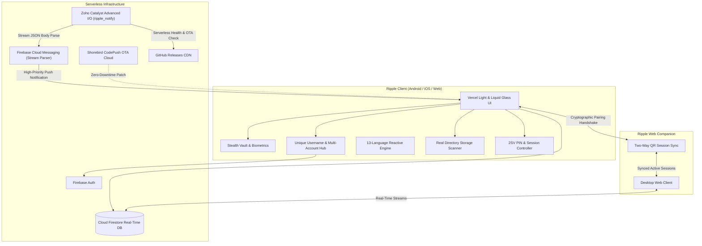

<p align="center">
  
</p>

<h1 align="center">Ripple</h1>

<p align="center">
  <strong>Sovereign Zero-Trace Encrypted Messenger & Real-Time Communications Suite</strong>
</p>

<p align="center">
  <a href="https://flutter.dev"></a>
  <a href="https://dart.dev"></a>
  <a href="https://firebase.google.com"></a>
  <a href="https://catalyst.zoho.com"></a>
  <a href="https://shorebird.dev"></a>
  <a href="PRIVACY.md"></a>
  <a href="LICENSE"></a>
</p>

---

## ⚡ Overview

**Ripple** is an elite, sovereign, zero-trace encrypted communications platform engineered for Android, iOS, and Desktop Web. Designed from first principles to prioritize user autonomy and mathematical confidentiality, Ripple pairs military-grade cryptographic protocols (**Signal Double Ratchet**, **X3DH**, **AES-256-GCM**) with the ultra-clean **Vercel Design System** (`@serafimcloud/themes/vercel` shadcn tokens) and custom GPU-accelerated **Liquid Glass** shaders.

Ripple delivers real-time two-way web pairing, hardware-backed biometric security, live storage directory scanning, Indian demographic localization across 13 languages, an uncrackable dial-code **Stealth Vault**, and dual-engine over-the-air updates.

---

## 🚀 Key Architectural Innovations

### 1. 🛡️ Sovereign Cryptographic Core
- **Signal Protocol & Double Ratchet**: Ephemeral session keys rotated on every message with immediate cryptographic deletion to guarantee forward and future secrecy.
- **Hardware Keystore Isolation**: Private keys, biometric credentials, and stealth vault states are anchored inside the Android Keystore / iOS Secure Enclave via `flutter_secure_storage`.
- **Zero Metadata Retention**: Servers retain zero message contents, sender-recipient routing graphs, or geo-telemetry.
- **Hardware Protection**: Android `FLAG_SECURE` prevents OS screen capture, screen recording, and task-switcher caching.

### 2. 🥷 Military-Grade Stealth Vault (Ghost Mode)
- **Zero-Trace Chamber**: Flagged conversations vanish entirely from the primary feed, unread badges, and global search.
- **Secret Dial Code Entry**: Enter your custom secret code (e.g., `*7777#`) directly into the Search Bar to instantly reveal the hidden partition.
- **App Bar Long-Press Trigger**: A 2.5-second tactile hold on the Ripple app bar logo challenges with biometric or 2SV PIN verification before opening the chamber.
- **Bidirectional Migration**: Safely migrate chats into and out of the vault with zero data loss or session disruption.

### 3. 🎨 Vercel Design System & Liquid Glass Shaders
- **Vercel Light Architecture**: Minimalist, high-contrast monochrome aesthetic inspired by `@serafimcloud/themes/vercel` (`#FAFAFA` canvas, `#09090B` high-contrast typography, `#E4E4E7` precision borders, and `#FFFFFF` cards).
- **GPU-Accelerated Liquid Glass**: Two-pass Gaussian blur with dynamic light/dark refraction index adaptation, chromatic aberration, and spring physics.
- **Responsive Layout Engine**: Effortlessly scales across smartphones, tablets, foldables, and desktop browsers.

### 4. 🇮🇳 Focused Indian Demographic Localization (13 Languages)
Comprehensive, app-wide reactive localization built for the Indian subcontinent and international users:
- **Languages Supported**: English, Arabic (العربية), Hindi (हिन्दी), Bengali (বাংলা), Telugu (తెలుగు), Marathi (मराठी), Tamil (தமிழ்), Urdu (اردو), Gujarati (ગુજરાતી), Kannada (ಕನ್ನಡ), Malayalam (മലയാളം), Punjabi (ਪੰਜਾਬੀ), and Odia (ଓଡ଼ିଆ).
- **Full Coverage**: 74 localized core application keys across all settings, navigation, vaults, chats, and modals.

### 5. 🔍 Real-Time Unique Username Enforcement
- **Collision Prevention**: Every user can claim a unique `@username` handle.
- **Debounced Cloud Queries**: 350ms debounced Firestore indexing checks handle uniqueness in real-time. If a handle is taken by another user, an immediate collision warning is displayed, gating profile updates until resolved.

### 6. 📊 Real-Time Storage & Data Usage Engines
- **True Directory Scanner**: Real-time scanning across `getApplicationDocumentsDirectory()`, temporary cache, SQLite chat databases, encrypted audio notes, and local backup partitions.
- **One-Tap Cache Purge**: Safely clear cached media and temporary thumbnails without deleting encrypted chat logs.
- **Hardware Byte Monitor**: Real sent and received byte counters tracking cellular vs. Wi-Fi consumption across messages, media, voice notes, and documents.

### 7. 🩺 Live System Diagnostics
- **Real Hardware Status**: Live battery percentage, charging state, OS architecture, and core system telemetry.
- **Network RTT & Serverless Ping**: Real cloud round-trip latency (ms) and live serverless health verification replacing static mockups.

### 8. 🌐 Web Companion Workstation (WhatsApp & Telegram Web Parity)
- **Instant Cryptographic QR Pairing**: Authenticate desktop browsers via end-to-end encrypted session handshake.
- **Full Real-Time Chat Synchronization**: Real-time Firestore streams mirror conversations, contacts, voice notes, and media attachments between mobile and web.
- **Voice Note Waveform Engine**: Interactive scrubable audio waveform player with `1.0x`, `1.5x`, and `2.0x` variable speed selection.
- **Smart Chat Folders**: Quick-filter by *All*, *Unread*, *Direct*, and *Groups*.

### 9. 🔄 Dual-Engine Over-the-Air Update System
- **Engine A (Shorebird Cloud)**: Instantaneous, zero-downtime hot-push of Dart compiled bytecode directly to user devices.
- **Engine B (Zoho Catalyst & GitHub OTA)**: Robust Advanced I/O stream parser (`ripple_notify`) querying GitHub Releases API with automated background update notifications and in-app APK installer.

---

## 🛠️ System Architecture



---

## 📦 Project Structure

```
ripple/
├── android/                     # Native Android Gradle configuration & Keystore
├── ios/                         # Native iOS runner & Keychain entitlements
├── web/                         # Flutter Web companion workstation runner
├── catalyst/                    # Zoho Catalyst Serverless Backend
│   └── functions/ripple_notify/ # Node.js Cloud Functions (/checkUpdate, stream parser)
├── release/                     # Production binary distribution (Git LFS tracked)
│   └── ripple-release.apk       # Ready-to-install Android Release APK
├── PRIVACY.md                   # Formal zero-metadata privacy disclosure
├── TERMS.md                     # Terms of Service & acceptable use agreement
├── lib/
│   ├── app.dart                 # Application root, theme binding & GoRouter routes
│   ├── main.dart                # Entry point & shader initialization
│   ├── core/
│   │   ├── constants/           # Colors, typography, and styling tokens
│   │   ├── services/            # UpdateService, StealthVaultService, NotificationService
│   │   ├── theme/               # Vercel Light Theme & Liquid Glass presets
│   │   └── utils/               # 13-Language Indian demographic dictionary, Haptics
│   ├── features/
│   │   ├── auth/                # Multi-Account authentication & unique username validator
│   │   ├── chat/                # Real-time messaging, bubbles, media viewer, saved messages
│   │   ├── calls/               # Daily.co WebRTC audio & video calling
│   │   ├── privacy/             # Stealth Vault, Chat Lock, App Gate, Blocklist
│   │   ├── profile/             # Real Storage Scanner, Diagnostics, Security Hub, L10n
│   │   ├── status/              # Ephemeral stories with auto-advancing progress
│   │   └── web_companion/       # Web pairing screen and desktop workstation
│   └── shared/                  # Reusable Liquid Glass cards, navigation bars, avatars
```

---

## 🔧 Getting Started

### Prerequisites
- **Flutter SDK**: `^3.7.0` (Dart `^3.7.0`)
- **Node.js**: `v18+` (for Zoho Catalyst deployment)
- **Java**: JDK 17 (for Android release builds)
- **Git LFS**: Installed and initialized (`git lfs install`)

### Environment Setup
Create a `.env` file in the project root:
```env
# Firebase Configuration
FIREBASE_API_KEY=your_firebase_api_key
FIREBASE_APP_ID=your_firebase_app_id
FIREBASE_MESSAGING_SENDER_ID=your_sender_id
FIREBASE_PROJECT_ID=ripple-cd77c
FIREBASE_STORAGE_BUCKET=ripple-cd77c.firebasestorage.app

# Zoho Catalyst Serverless
CATALYST_PROJECT_ID=78655000000036001
CATALYST_FUNCTION_URL=https://ripple-60091711787.development.catalystserverless.in/server/ripple_notify

# Calling & CDN
DAILY_API_KEY=your_daily_co_key
DAILY_DOMAIN=ripple.daily.co
SUPABASE_URL=your_supabase_url
SUPABASE_ANON_KEY=your_supabase_anon_key
CLOUDINARY_CLOUD_NAME=your_cloudinary_name
```

### Build & Run Commands

```bash
# 1. Clone repository & pull Git LFS binaries
git clone https://github.com/Masthan008/Ripple.git
cd Ripple/ripple
git lfs pull

# 2. Install dependencies
flutter pub get

# 3. Run on connected Android / iOS device
flutter run

# 4. Run Desktop Web Companion Workstation
flutter run -d chrome

# 5. Build Production Release APK
flutter build apk --release
```

---

## 🛡️ Sovereign Security & Privacy Guarantees

- **Zero-Trace Architecture**: No cloud logging of unread message badges, contacts, or message bodies.
- **Hardware Biometric Lock**: 2SV PIN and Biometrics guard access to the app, secret conversations, and system settings.
- **True Account Erasure**: The "Delete Account" action irreversibly destroys authentication credentials, cloud records, and local encryption keys across all platforms.
- **Formal Documentation**: Review our comprehensive [PRIVACY.md](PRIVACY.md) and [TERMS.md](TERMS.md).

---

## 📄 License

This project is licensed under the MIT License - see the [LICENSE](LICENSE) file for details.
