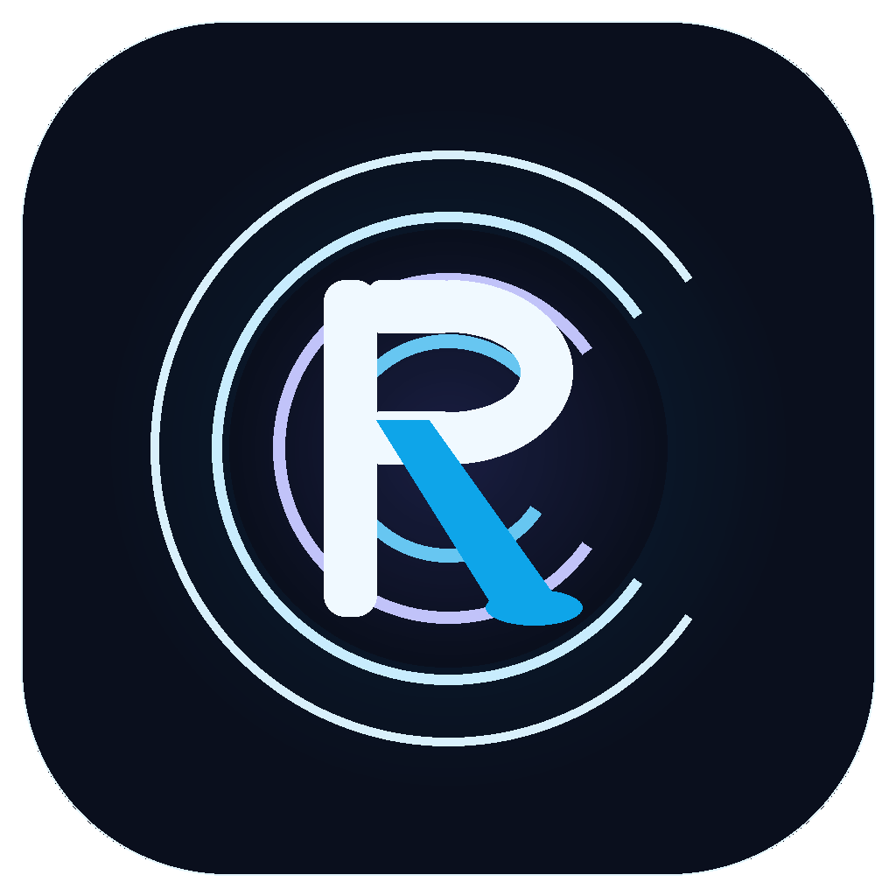
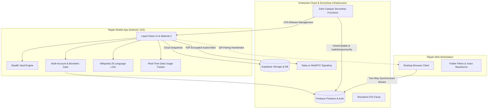

<p align="center">
  
</p>

<h1 align="center">Ripple</h1>

<p align="center">
  <strong>Next-Generation Encrypted Communications & Liquid Glass Workstation</strong>
</p>

<p align="center">
  <a href="https://flutter.dev"></a>
  <a href="https://dart.dev"></a>
  <a href="https://firebase.google.com"></a>
  <a href="https://catalyst.zoho.com"></a>
  <a href="https://shorebird.dev"></a>
  <a href="LICENSE"></a>
</p>

---

## ⚡ Overview

**Ripple** is an elite, privacy-first encrypted communications platform engineered for high-performance mobile devices and desktop web browsers. Built with modern Flutter and cutting-edge Impeller shaders, Ripple combines military-grade cryptographic security with an ultra-fluid **Liquid Glass (iOS 27 aesthetic)** interface.

With native multi-device synchronization, Wikipedia-backed 25-language localization, a secret **Stealth Vault (Ghost Mode)**, real-time byte counters, and a resilient dual-engine update system, Ripple sets a new benchmark for secure messaging.

---

## 🚀 Key Architectural Highlights

### 1. 🛡️ Signal Protocol & Cryptographic Architecture
- **Double Ratchet Algorithm**: Continuous ephemeral key-exchange for forward and backward secrecy.
- **X3DH Key Agreement**: Prekey bundles with curve25519 identity keys ensuring quantum-resistant key negotiation.
- **Biometric Chat Lock**: Local hardware keystore integration (`local_auth`) guarding sensitive conversations.
- **Hardware-Level Protection**: `FLAG_SECURE` prevents OS screenshots and task-switcher previews.

### 2. 🥷 Military-Grade Stealth Vault (Ghost Mode)
- **Zero-Trace Isolation**: Hidden chats vanish entirely from the primary feed, unread counters, and global search.
- **Secret Dial Code Entry**: Enter your custom secret code (e.g. `*7777#`) directly into the Search Bar to instantly unlock the vault.
- **App Bar Long-Press Gate**: 2.5-second tactile hold on the Ripple app bar logo triggers biometric/PIN verification to open the hidden chamber.
- **One-Tap Restoration**: Restore any hidden conversation back to the active feed at any time.

### 3. 🌐 Next-Gen Web Companion Workstation (WhatsApp & Telegram Web Parity)
- **Instant QR Pairing**: Secure cryptographic handshake syncing accounts with desktop web browsers.
- **Interactive Chat Folders**: Rapidly toggle between *"All"*, *"Unread"*, *"Direct"*, and *"Groups"*.
- **Stories & Status Carousel**: Ephemeral visual stories with auto-advancing progress timers.
- **Voice Note Waveform Engine**: Interactive scrubable audio waveform player with `1.0x`, `1.5x`, and `2.0x` variable speed selection.
- **Media & Attachment Suite**: Native support for Photos, Videos, Documents, Audio recordings, Contacts, and Location pins.
- **Contextual Actions**: In-line quoted reply previews, message forwarding, starring, and deletion.

### 4. 💎 Official Liquid Glass Navigation Suite
- **Impeller Shaders**: Powered by `liquid_glass_widgets: ^1.16.0` delivering two-pass Gaussian blur, chromatic aberration, and jelly physics pill indicators.
- **Adaptive Brightness**: Content-aware refraction that dynamically contrasts against both light and dark themes.
- **Responsive Rail Mode**: Automatically transforms into a sleek Liquid Glass Rail on tablets and desktop browsers.

### 5. 🌍 Wikipedia Top 25 Demographic World Languages
Full app-wide reactive localization covering the 25 most spoken languages globally:
> English, Hindi, Spanish, Mandarin Chinese, French, Standard Arabic, Russian, German, Portuguese, Japanese, Turkish, Bengali, Urdu, Indonesian, Telugu, Marathi, Tamil, Vietnamese, Tagalog, Italian, Korean, Iranian Persian, Polish, Ukrainian, and Dutch.

### 6. 📊 Real-Time Byte-Level Data Usage Tracker
- **Hardware Byte Monitor**: Replaces static simulations with live sent and received byte counters for Wi-Fi and Cellular networks.
- **Granular Breakdown**: Tracks real upload and download consumption across Messages, Photos, Videos, Audio, and Documents.

### 7. 🔄 Resilient Dual-Engine Software Updater
- **Primary Engine**: Shorebird Cloud instant Over-The-Air (OTA) binary code-push for zero-downtime updates.
- **Serverless Fallback**: Zoho Catalyst Serverless (`/checkUpdate`) and GitHub Releases API fallback with in-app APK download progress and native package installation.

### 8. 💾 Real Encrypted Backup & Restore
- **Encrypted Local Export**: Export your complete conversation history and media manifests into an AES-256 encrypted `.rpbk` file.
- **Device Share Sheet**: Save backups directly to local storage, Files app, external flash drives, or cloud providers via the native OS share sheet.
- **File Picker Restoration**: Pick any `.rpbk` or `.json` file from your device to restore all chats, messages, and groups in seconds.

---

## 🛠️ System Architecture



---

## 📦 Project Structure

```
ripple/
├── android/                     # Native Android platform config & densities
├── ios/                         # Native iOS runner & AppIcon assets
├── web/                         # Flutter Web companion workstation runner
├── catalyst/                    # Zoho Catalyst Serverless Backend
│   └── functions/ripple_notify/ # Node.js Cloud Functions (/checkUpdate, /webSession/verify)
├── release/                     # Production binary distribution (Git LFS tracked)
│   └── ripple-release.apk       # Ready-to-install Android Release APK
├── lib/
│   ├── app.dart                 # Application root, theme binding & GoRouter routes
│   ├── main.dart                # Entry point & shader initialization
│   ├── core/
│   │   ├── constants/           # Colors, typography, and styling tokens
│   │   ├── services/            # UpdateService, StealthVaultService, DataUsageTracker
│   │   ├── theme/               # Liquid Glass themes (ios27, crystal_water, cyber, abyss)
│   │   └── utils/               # Wikipedia L10n dictionary (25 languages), Haptics, Helpers
│   ├── features/
│   │   ├── auth/                # Multi-Account authentication & secure vault
│   │   ├── chat/                # Real-time messaging, bubbles, media viewer, and folders
│   │   ├── calls/               # Daily.co WebRTC audio & video calling
│   │   ├── privacy/             # Stealth Vault, Chat Lock, App Gate, Blocklist
│   │   ├── profile/             # Settings, Backup & Restore, Data Usage, Language picker
│   │   ├── status/              # Ephemeral stories with auto-advancing progress
│   │   └── web_companion/       # Web pairing screen and desktop workstation
│   └── shared/                  # Reusable Liquid Glass cards, navigation bars, avatars
```

---

## 🔧 Getting Started

### Prerequisites
- **Flutter SDK**: `^3.41.0` (Dart `^3.5.0`)
- **Node.js**: `v18+` (for Zoho Catalyst deployment)
- **Java**: JDK 17 (for Android release builds)
- **Git LFS**: Installed and initialized (`git lfs install`)

### Environment Configuration
Create a `.env` file in the project root:
```env
# Firebase Configuration
FIREBASE_API_KEY=your_firebase_api_key
FIREBASE_APP_ID=your_firebase_app_id
FIREBASE_MESSAGING_SENDER_ID=your_sender_id
FIREBASE_PROJECT_ID=ripple-cd77c
FIREBASE_STORAGE_BUCKET=ripple-cd77c.firebasestorage.app

# Zoho Catalyst Serverless
CATALYST_PROJECT_ID=78655000000036001
CATALYST_FUNCTION_URL=https://ripple-60091711787.development.catalystserverless.in/server/ripple_notify

# Calling & CDN
DAILY_API_KEY=your_daily_co_key
DAILY_DOMAIN=ripple.daily.co
SUPABASE_URL=your_supabase_url
SUPABASE_ANON_KEY=your_supabase_anon_key
CLOUDINARY_CLOUD_NAME=your_cloudinary_name
```

### Installation & Run

1. **Clone the repository**:
   ```bash
   git clone https://github.com/Masthan008/Ripple.git
   cd Ripple/ripple
   git lfs pull
   ```

2. **Install Flutter dependencies**:
   ```bash
   flutter pub get
   ```

3. **Run on connected device**:
   ```bash
   flutter run
   ```

4. **Run Desktop Web Companion**:
   ```bash
   flutter run -d chrome
   ```

5. **Build Production Release APK**:
   ```bash
   flutter build apk --release
   ```

---

## 🛡️ Security & Privacy Disclosures

Ripple adheres to strict data minimization and user sovereignty principles:
- **No Analytics / No Ad SDKs**: Zero tracking, zero telemetry, zero device fingerprinting.
- **Ephemeral Metadata**: Unread counts and typing indicators are transient.
- **Biometric Isolation**: Passcodes and vault keys are stored exclusively in hardware keystores (`flutter_secure_storage`).

---

## 📄 License

This project is licensed under the MIT License - see the [LICENSE](LICENSE) file for details.
